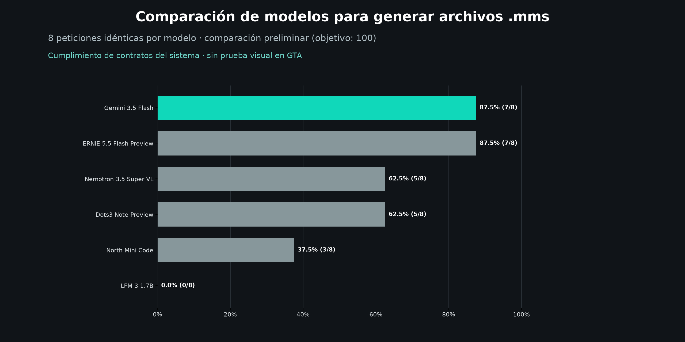

# Gemini frente a cinco modelos por API



Modelos conectados: **Gemini 3.5 Flash** mediante Google; **ERNIE 5.5 Flash Preview,
Nemotron 3.5 Super VL, Dots3 Note Preview, North Mini Code y LFM 3 1.7B** mediante
OpenRouter. Los cinco modelos de OpenRouter tienen tarifa cero en el catálogo.
No hay entrenamiento ni porcentajes prefijados.

## Resultados ejecutados: muestra preliminar

Se evaluaron 48 respuestas: los mismos ocho casos por modelo. Se exportaron 27
archivos MMS. Estos resultados no completan todavía los 100 casos previstos.

| Modelo | Casos correctos | Exactitud en la muestra |
| --- | ---: | ---: |
| Gemini 3.5 Flash | 7/8 | 87,5 % |
| ERNIE 5.5 Flash Preview | 7/8 | 87,5 % |
| Nemotron 3.5 Super VL | 5/8 | 62,5 % |
| Dots3 Note Preview | 5/8 | 62,5 % |
| North Mini Code | 3/8 | 37,5 % |
| LFM 3 1.7B | 0/8 | 0,0 % |

Gemini y ERNIE empataron en esta muestra. La tabla refleja la ejecución inicial;
el informe y la gráfica se actualizan al ampliar las pruebas.

## Ejecutar o reanudar

Las claves GEMINI_API_KEY y OPENROUTER_API_KEY se leen del archivo local .env,
excluido de Git. El cliente comprueba ambas tarifas, exige el sufijo :free y fija
un precio máximo de cero en OpenRouter. No cambia límites de gasto de la cuenta.

```powershell
# Regenerar informe y gráfica sin consumir API:
.\.venv-analysis\Scripts\python.exe comparar_llms.py
# Primera muestra: ocho peticiones idénticas por modelo:
.\.venv-analysis\Scripts\python.exe comparar_llms.py --ejecutar --limite 8
# Ampliar hasta 100 por modelo cuando las cuotas lo permitan:
.\.venv-analysis\Scripts\python.exe comparar_llms.py --ejecutar
# Reintentar únicamente Gemini:
.\.venv-analysis\Scripts\python.exe comparar_llms.py --ejecutar --limite 8 --modelo gemini
# Revalidar respuestas existentes tras una corrección del compilador, sin API:
.\.venv-analysis\Scripts\python.exe comparar_llms.py --revalidar
```

Se requiere el entorno del proyecto y Matplotlib (requirements-analysis.txt).
Las cuotas gratuitas y la disponibilidad pueden interrumpir la ejecución. Se
guarda cada respuesta; al reanudar no se repiten las recibidas, incluidas las
incorrectas. Los errores HTTP o de red se registran aparte y se pueden reintentar.

## Interpretar la gráfica

La métrica es **exactitud por escena**: porcentaje de casos que cumplen todos los
contratos aplicables del evaluador. No es precisión de una clase positiva ni una
medida de superioridad universal. JSON inválido, respuesta vacía o truncada e
incumplimientos de acciones, reparto, ambiente o duración cuentan como fallos.

Se comparan exclusivamente los mismos IDs respondidos por los seis modelos. Con
menos de 100 se muestra **comparación preliminar** y el denominador real. Con ocho
casos, un acierto equivale a 12,5 puntos; no basta para concluir superioridad general.
La gráfica ordena los modelos por los aciertos medidos y distingue Gemini en verde.

## Método y límites

- Corpus artificial existente: 100 casos seleccionados con semilla 20261111 antes
  de recibir respuestas; contratos esperados en casos.json. No son anotaciones
  humanas independientes ni un conjunto de entrenamiento.
- Mensajes congelados en prompts.json: esquema JSON, catálogo textual recuperado
  y borrador del planificador local, idénticos para todos. No se envían contratos
  esperados, imágenes ni el catálogo completo todo.txt.
- El borrador ayuda a todos los candidatos. Se mide el sistema asistido por cada
  LLM: plan JSON, validador, completador y compilador MMS compartidos. No es
  generación directa de MMS por el LLM aislado.
- Temperatura solicitada: 0,1; máximo de salida: 8192 tokens. Los proveedores
  gestionan razonamiento y tokens de forma diferente; se conserva la respuesta
  completa para auditar truncamientos y motivos de finalización.
- Se guardan plan crudo, plan final y MMS cuando puede exportarse. Se aplica
  evaluar_escenas.comprobar. Los bloques Markdown se desempaquetan por igual;
  no se reparan respuestas mediante otra IA ni se elige el mejor intento.
- Peticiones intercaladas, hasta tres en vuelo y separadas al menos 3,1 segundos
  en OpenRouter. Un fallo de acceso detiene ese modelo en la ejecución actual.
- No se mide reproducción visual en GTA, calidad de cámara ni seguridad de rutas.

## Evidencia

- [Informe JSON](informe.json) y [tabla CSV](informe.csv).
- [Gráfica PNG](comparacion.png) y [gráfica SVG](comparacion.svg).
- resultados/<modelo>/: respuestas originales, planes, errores y archivos MMS.
- configuracion.json: modelos, proveedores, parámetros y huellas SHA-256 del
  corpus, mensajes y código; bloquea mezclar respuestas de configuraciones distintas.
- catalogo_api.json: catálogo gratuito consultado para esta ejecución.
- prueba_acceso.json: pruebas de acceso, independientes de la medición.
- revisiones/: configuración y código anteriores a la corrección de escritura
  de saltos CRLF en Windows. Se revalidaron las mismas 48 respuestas sin nuevas
  consultas; las métricas no cambiaron. Cada registro conserva la firma anterior.

La latencia incluye espera, red y evaluación. usage conserva lo declarado por
cada API; la ausencia de costo en Google no demuestra por sí sola una factura
cero. Los rechazos del intento anterior con modelos de pago se conservan en sus
carpetas y no entran en esta comparación: tienen otros modelos y otra firma.

Fuentes: [catálogo gratuito de OpenRouter](https://openrouter.ai/collections/free-models),
[límites de OpenRouter](https://openrouter.ai/docs/api/reference/limits),
[API de Google](https://ai.google.dev/gemini-api/docs/models).
